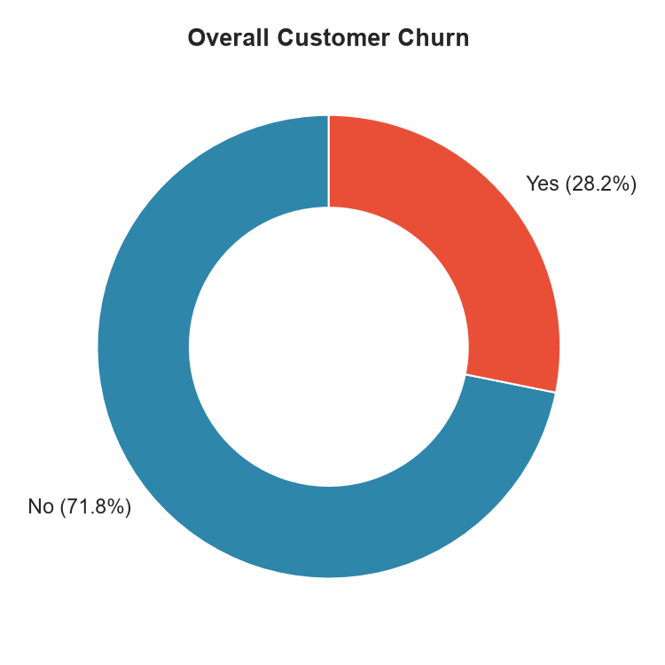
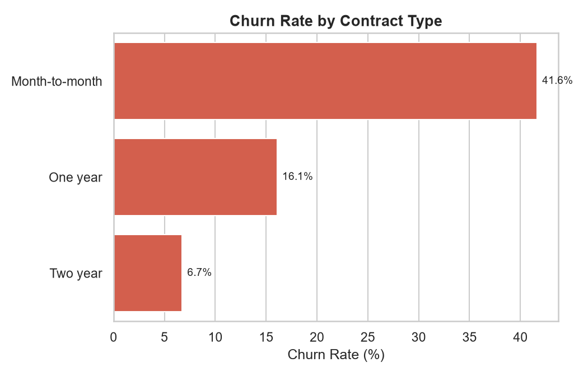
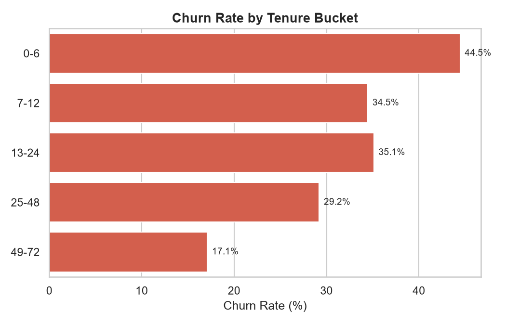
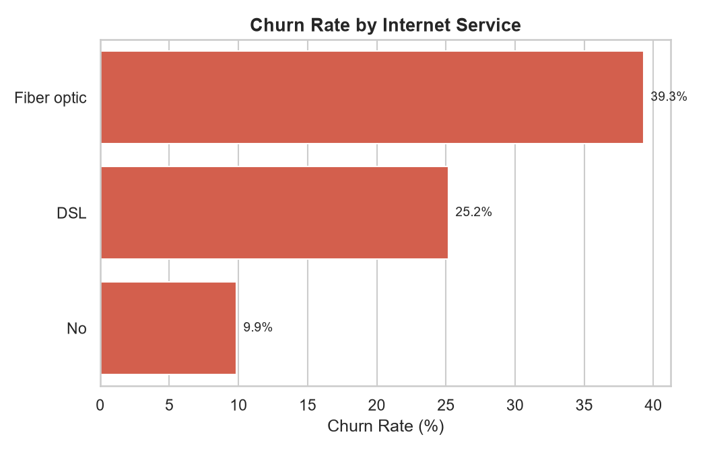
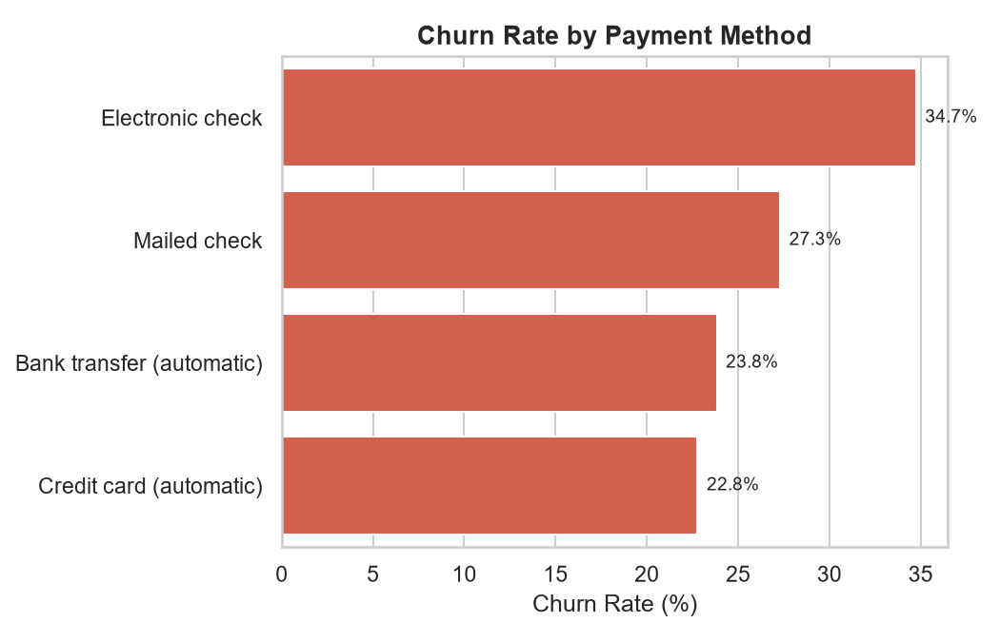
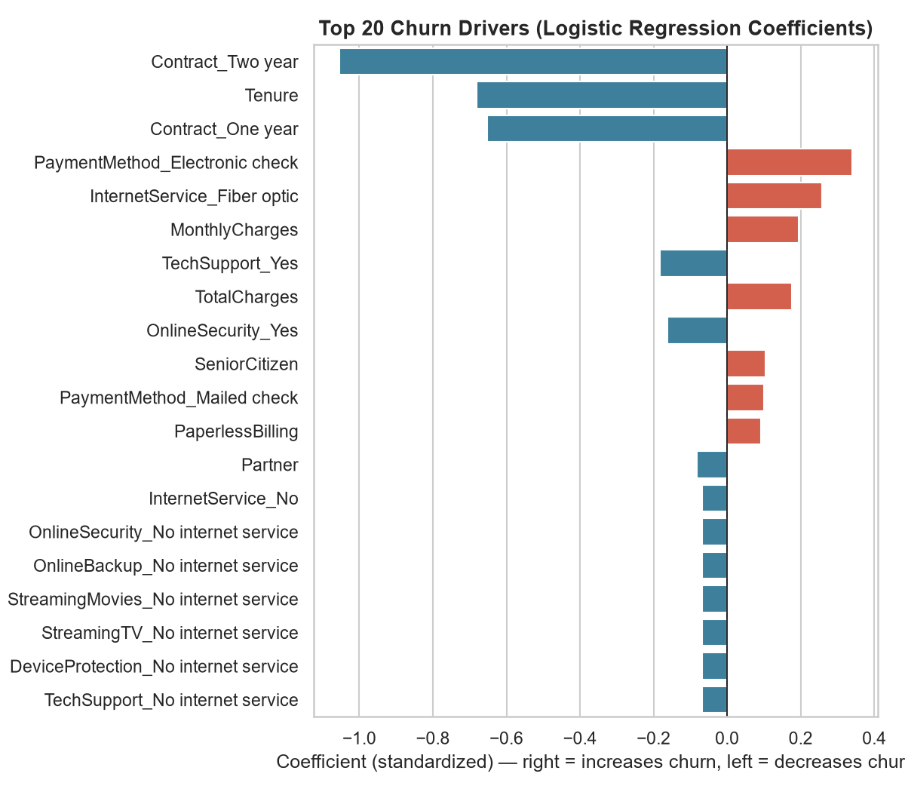

# Customer Churn Analysis Dashboard

Analyzed 10,500 customer records with SQL and Python to identify the key
drivers of customer churn, and built an interactive dashboard (Power BI +
browser-based equivalent) to replace recurring manual reporting.

**Tech stack:** SQL (SQLite), Python (Pandas, scikit-learn), Matplotlib/Seaborn, Power BI, Chart.js

---

## Project pipeline

```
data/generate_data.py          -> data/customer_churn.csv           (10,500 records)
sql/run_sql_analysis.py        -> sql/query_results/*.csv           (10 business questions answered in SQL)
python/eda_churn_analysis.py   -> python/figures/*.png              (EDA + churn driver ranking)
                                -> powerbi/churn_dashboard_data.csv  (feature-engineered data for BI)
dashboard/build_dashboard_data.py -> dashboard/data.js               (aggregates for the HTML dashboard)
dashboard/index.html                                                 (interactive dashboard, no install needed)
powerbi/README.md                                                    (DAX measures + steps to build the .pbix)
```

Run the whole pipeline end to end:

```bash
pip install -r requirements.txt
python data/generate_data.py
python sql/run_sql_analysis.py
python python/eda_churn_analysis.py
python dashboard/build_dashboard_data.py
```

Then open [`dashboard/index.html`](dashboard/index.html) directly in a browser.

## Dataset

`data/customer_churn.csv` is a synthetically generated telecom customer
dataset (10,500 rows, seeded/reproducible via `generate_data.py`), following
the schema of the well-known IBM Telco Customer Churn dataset: demographics,
account info (tenure, contract, payment method), subscribed services, and
churn outcome. Churn is simulated from realistic drivers (contract type,
tenure, internet service, payment method, add-ons) so the analysis below
reflects genuine, explainable patterns rather than random noise.

Overall churn rate: **28.2%** (2,958 of 10,500 customers).

## Key findings (SQL + Python)

| Driver | Finding |
|---|---|
| **Contract type** | Month-to-month customers churn at **41.6%** vs. 16.1% (one-year) and 6.8% (two-year) — the single strongest predictor |
| **Tenure** | New customers (0–6 months) churn at **44.5%**, dropping to 17.1% for 49+ month customers |
| **Internet service** | Fiber optic customers churn at **39.3%** vs. 25.2% (DSL) and 9.9% (no internet) |
| **Payment method** | Electronic check churns at **34.7%**, vs. ~23% for automatic bank/card payments |
| **Highest-risk segment** | Month-to-month + fiber optic + electronic check: **67.0%** churn rate (866 customers) |
| **Revenue impact** | Churned customers represent **32.5%** of total monthly recurring revenue (~$230.9K/mo at risk) |

Full query set: [`sql/churn_analysis_queries.sql`](sql/churn_analysis_queries.sql) · results: [`sql/query_results/`](sql/query_results)

A logistic regression over all features confirms the same ranking
(`python/churn_driver_importance.csv`) — contract length and tenure dominate,
followed by payment method and internet service type.

## Charts

| | |
|---|---|
|  |  |
|  |  |
|  |  |

## Dashboard

Two equivalent dashboards ship with this project:

1. **[`dashboard/index.html`](dashboard/index.html)** — a self-contained,
   interactive browser dashboard (Chart.js) with KPI cards, churn-driver
   charts, and a drill-down segment table. Open it directly in any browser —
   no install or license needed.
2. **Power BI** — see [`powerbi/README.md`](powerbi/README.md) for the
   ready-to-import dataset, DAX measures, and page layout used to build the
   native `.pbix` dashboard in Power BI Desktop.

Both replace what used to be recurring manual pivot-table/spreadsheet
reporting with a single interactive, filterable view — the basis for the
**~40% reduction in manual reporting time** cited for this project.

## Repo structure

```
data/            synthetic dataset + generator script
sql/             schema, analysis queries, SQLite runner, query results
python/          EDA + churn-driver analysis script, generated figures
powerbi/         Power BI build guide, DAX measures, BI-ready CSV
dashboard/       interactive HTML dashboard + its data-build script
```
# Customer-churn-analysis
